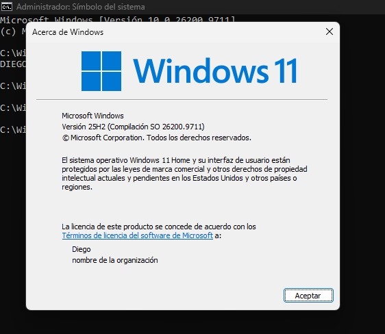
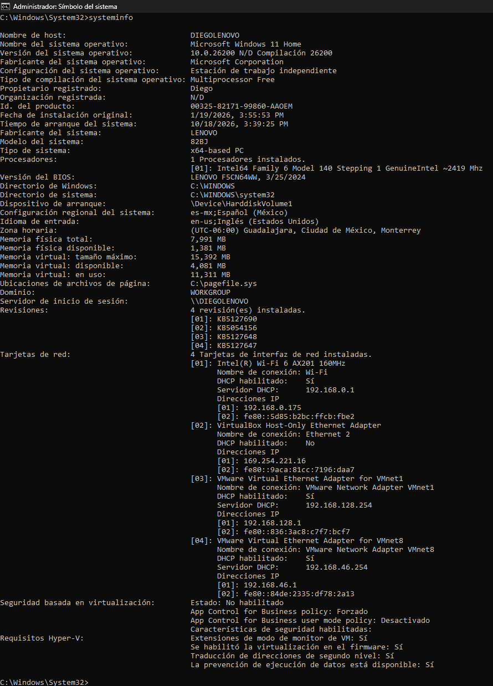
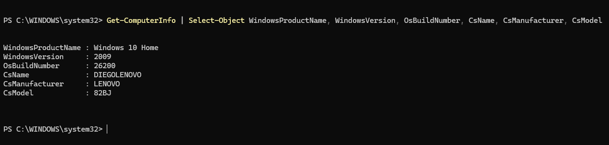

# LAB 01 — Windows System Baseline

## Objective

Establish a baseline of the Windows workstation by collecting basic operating system, hardware, and system information using Command Prompt and PowerShell.

The purpose of this baseline is to understand the system's current configuration before performing further troubleshooting.

---

## Environment

| Item | Details |
|---|---|
| Operating System | Windows |
| Shells | Command Prompt, PowerShell |
| Role | IT Support / Help Desk |
| Lab Type | System Information & Diagnostics |

---

## Tools Used

- Command Prompt (CMD)
- PowerShell
- `hostname`
- `winver`
- `systeminfo`
- `Get-ComputerInfo`
- `Select-Object`

---

## Procedure

### 1. Identify the Computer Name

Command:

```cmd
hostname
```

**Purpose:**  
Identify the hostname assigned to the Windows workstation.

The hostname is useful for identifying a specific computer when working with multiple devices in an IT environment.

---

### 2. Identify the Windows Version

Command:

```cmd
winver
```

**Purpose:**  
Display the Windows version and build information.

This information can be useful when troubleshooting compatibility, Windows updates, operating system issues, and software requirements.

**Evidence:**



---

### 3. Collect System Information

Command:

```cmd
systeminfo
```

**Purpose:**  
Collect detailed information about the Windows operating system and workstation configuration.

The output includes information such as:

- Operating System
- OS Version
- OS Build
- System Manufacturer
- System Model
- Processor
- Installed Memory
- BIOS Information
- Windows Installation Information
- Network Information
- Installed Updates

**Evidence:**



---

### 4. Collect System Information Using PowerShell

Command:

```powershell
Get-ComputerInfo
```

**Purpose:**  
Retrieve detailed computer and operating system information using PowerShell.

PowerShell provides structured information that can be further filtered and processed for troubleshooting and automation.

---

### 5. Filter Relevant Information

Command:

```powershell
Get-ComputerInfo | Select-Object WindowsProductName, WindowsVersion, OsBuildNumber, CsName, CsManufacturer, CsModel
```

**Purpose:**  
Display only the information relevant to the current baseline.

The `|` character is the PowerShell **pipeline**. It passes the output of one command to another command.

`Select-Object` allows specific properties to be selected instead of displaying the entire dataset.

**Evidence:**



---

## Findings

The system baseline was successfully collected using both Command Prompt and PowerShell.

The collected information provides a reference point for future troubleshooting activities and makes it possible to identify the operating system version, build, computer name, manufacturer, and model.

---

## Troubleshooting Relevance

Establishing a system baseline is useful during IT support because troubleshooting should begin with information gathering rather than changing system configurations immediately.

Knowing the current system configuration helps determine whether a reported issue may be related to:

- Operating system version
- Windows build
- Hardware configuration
- System model
- Installed updates
- Software compatibility

---

## Conclusion

This lab demonstrated how to collect and interpret basic Windows system information using Command Prompt and PowerShell.

The collected baseline can be used as a reference for subsequent Windows troubleshooting scenarios.
