# LAB 02 — Processes and Services

## Objective

The goal of this lab was to practice identifying and troubleshooting **Windows processes and services** using **Command Prompt (CMD)** and **PowerShell**.

These are common tasks in IT Support because processes and services can affect application performance, system functionality, updates, and overall Windows stability.

---

## Environment

| Item | Details |
|---|---|
| Operating System | Windows 11 |
| Tools | Command Prompt, PowerShell |
| Privileges | Administrator |
| Main topics | Processes, Services, Windows Update |

---

## Tools Used

- **Command Prompt (CMD)**
- **PowerShell**
- `tasklist`
- `findstr`
- `Get-Process`
- `Get-Service`
- `Get-CimInstance`
- `Restart-Service`

---

# 1. Reviewing Running Processes

The first step was to inspect the processes currently running on the system.

### Command

```cmd
tasklist
```

This command displays the processes currently running in Windows, including their **Process ID (PID)** and memory usage.

### Evidence

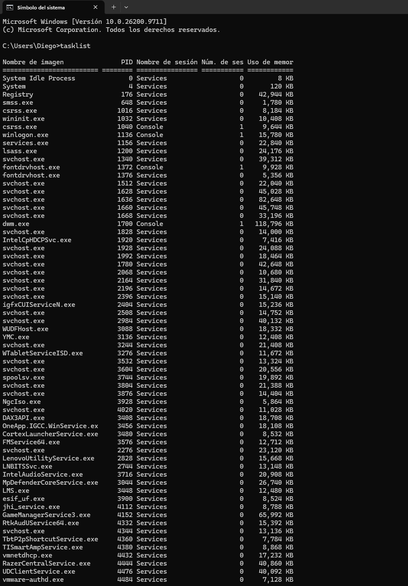

---

# 2. Searching for a Specific Process

Instead of reviewing the entire list, `findstr` can be used to search for a specific process.

### Command

```cmd
tasklist | findstr explorer
```

This filters the output of `tasklist` and displays only entries containing `explorer`.

The `explorer.exe` process is responsible for important parts of the Windows user interface, including **File Explorer** and the desktop.

### Evidence

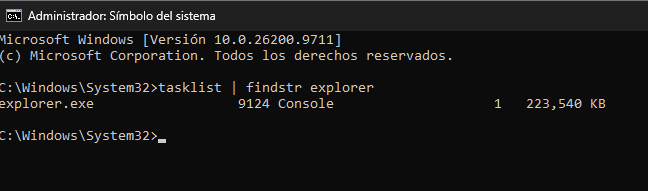

---

# 3. Finding a Process with PowerShell

PowerShell provides more flexible ways to search for processes.

### Command

```powershell
Get-Process | Where-Object {$_.ProcessName -like "*explorer*"}
```

This command retrieves the processes and filters the results to find processes whose name contains `explorer`.

The result confirmed that the `explorer` process was running.

### Evidence

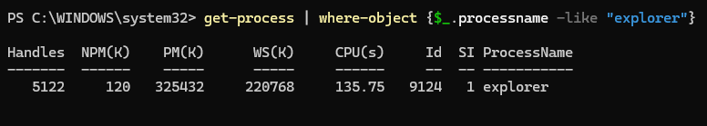

---

# 4. Reviewing Windows Services

Processes and services are different.

A **process** is a running instance of a program.

A **service** is a Windows component designed to run in the background and provide specific functionality to the operating system or applications.

To list Windows services:

### Command

```powershell
Get-Service
```

The output shows the service status, internal name, and display name.

### Evidence

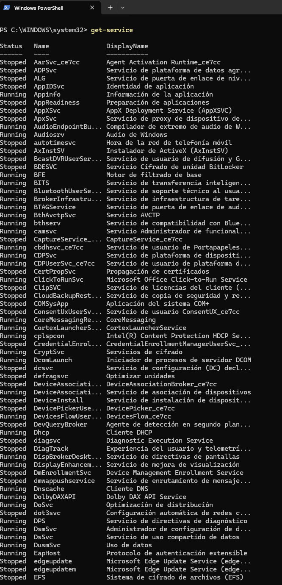

---

# 5. Checking the Windows Update Service

A common Help Desk troubleshooting task is checking whether the Windows Update service is running.

### Command

```powershell
Get-Service -Name wuauserv
```

The service name `wuauserv` corresponds to **Windows Update**.

The service was found in the following state:

```text
Status  : Stopped
Name    : wuauserv
DisplayName : Windows Update
```

This was an important finding because Windows Update depends on this service to perform update-related operations.

### Evidence

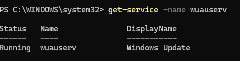

---

# 6. Reviewing Service Details

Additional information about the Windows Update service was retrieved using:

### Command

```powershell
Get-Service -Name wuauserv | Format-List *
```

This provides more detailed information about the service instead of only displaying the basic status.

This type of command can be useful when investigating why a service is not working as expected.

### Evidence

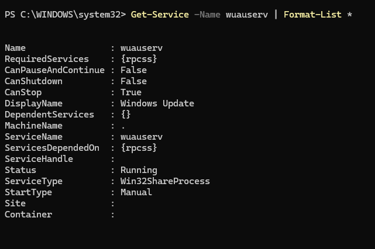

---

# 7. Listing Running Services

To identify only services that are currently running:

### Command

```powershell
Get-Service | Where-Object {$_.Status -eq "Running"}
```

This filters the complete list of services and returns only those whose status is `Running`.

This can be useful when troubleshooting whether a required Windows component is currently active.

### Evidence

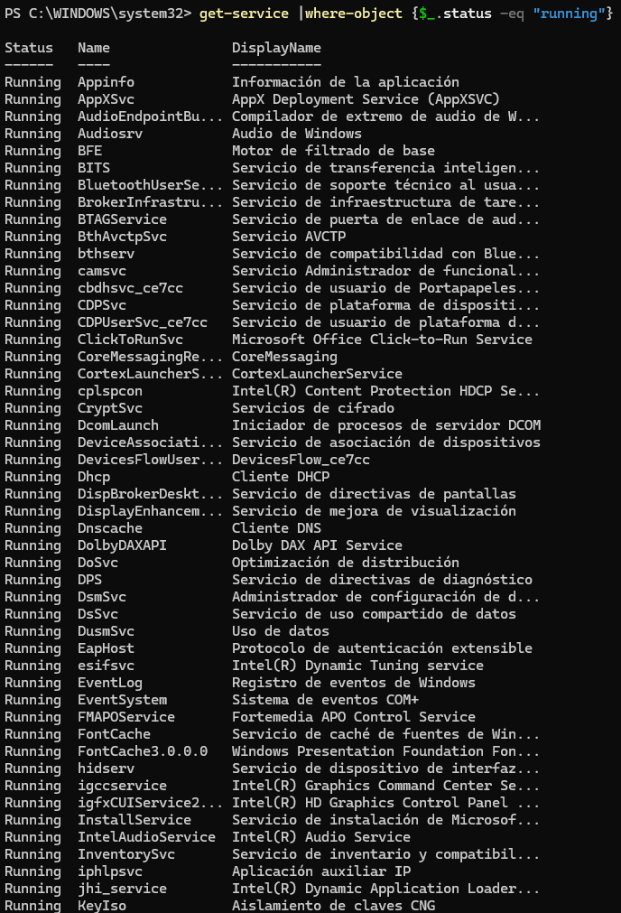

---

# 8. Searching for Windows-Related Services

PowerShell can also be used to search services based on their display name.

### Command

```powershell
Get-Service | Where-Object {$_.DisplayName -like "*Windows*"}
```

This returned multiple services related to Windows, including **Windows Update**, **Windows Defender Firewall**, **Windows Search**, and other system components.

### Evidence

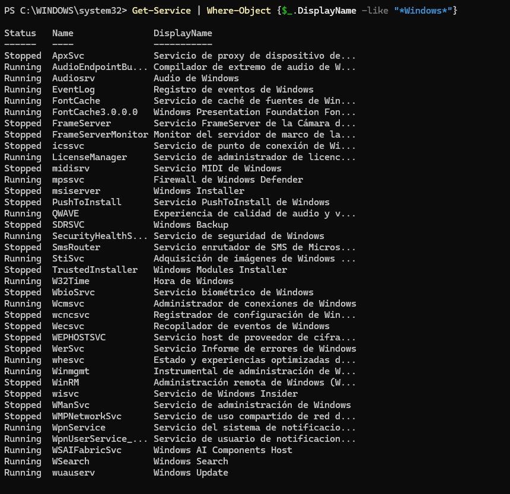

---

# 9. Checking Windows Update Configuration

To obtain additional information about the Windows Update service, including its startup configuration:

### Command

```powershell
Get-CimInstance Win32_Service -Filter "Name='wuauserv'" | Select-Object Name, DisplayName, State, StartMode
```

The result was:

```text
Name      DisplayName    State    StartMode
wuauserv  Windows Update  Stopped  Manual
```

This showed that:

- The service was **Stopped**.
- Its startup mode was **Manual**.

This is useful information when troubleshooting a Windows Update problem because the service was not currently running.

### Evidence

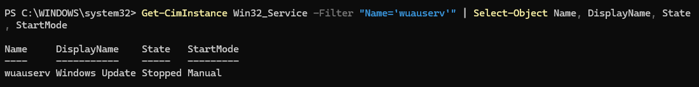

---

# 10. Attempting to Restart Windows Update

The next troubleshooting step was to attempt to restart the Windows Update service.

### Commands

```powershell
Get-Service -Name wuauserv
Restart-Service -Name wuauserv
Get-Service -Name wuauserv
```

The restart operation **failed**.

PowerShell returned a `CouldNotStopService` error indicating that Windows could not stop/open the service as required by the restart operation.

After the failed attempt, the service remained:

```text
Status  : Stopped
Name    : wuauserv
DisplayName : Windows Update
```

This is an important troubleshooting result. The command did not resolve the problem, so the issue would require additional investigation rather than assuming that the service had been successfully restarted.

### Evidence

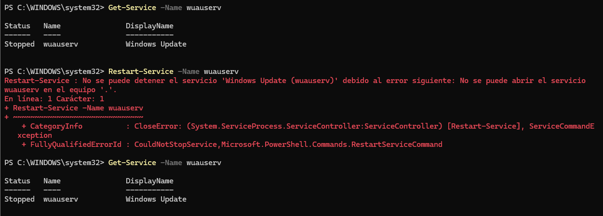

---

# 11. Checking the Explorer Process

The `explorer` process was also checked directly using PowerShell.

### Command

```powershell
Get-Process -Name explorer
```

This confirmed that the Windows Explorer process was running.

### Evidence

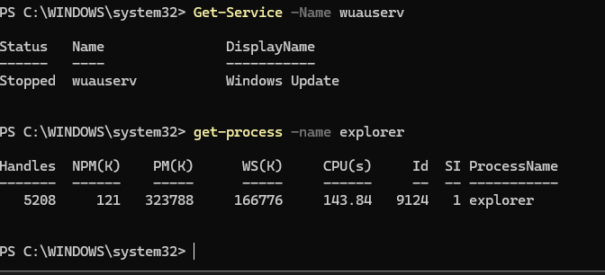

---

# 12. Checking Explorer Resource Usage

Finally, specific information about the Explorer process was retrieved.

### Command

```powershell
Get-Process -Name explorer | Select-Object Name, Id, CPU, WorkingSet
```

This displayed information including:

- Process name
- Process ID
- CPU usage
- Memory usage (`WorkingSet`)

This type of information can help identify processes that may be consuming excessive system resources.

### Evidence

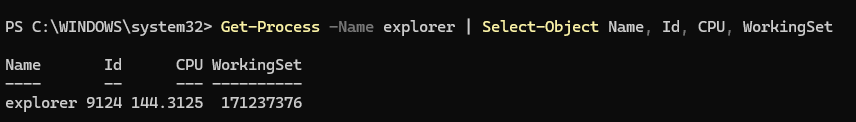

---

# Findings

During the lab, the main troubleshooting finding was related to **Windows Update**.

The `wuauserv` service was found to be:

```text
State     : Stopped
StartMode : Manual
```

An attempt was made to restart the service using:

```powershell
Restart-Service -Name wuauserv
```

However, the operation failed with a `CouldNotStopService` error, and the service remained stopped.

This demonstrates an important Help Desk principle:

> A troubleshooting command should not automatically be considered successful just because it was executed.

The result must always be verified afterward.

---

# Troubleshooting Relevance

These commands are useful in real IT Support scenarios such as:

- Applications not responding
- Windows Explorer problems
- High CPU or memory usage
- Windows Update problems
- Services that are stopped unexpectedly
- Identifying whether a required Windows component is running
- Gathering information before escalating a ticket

For example, if a user reports that Windows Update is not working, a technician can first check:

```powershell
Get-Service -Name wuauserv
```

If the service is stopped, the technician can investigate its configuration and attempt an appropriate recovery action.

If the recovery action fails, the technician now has useful evidence for further troubleshooting or escalation.

---

# Conclusion

This lab provided hands-on practice with Windows **processes and services** using both CMD and PowerShell.

The main concepts practiced were:

- Listing running processes
- Searching for specific processes
- Identifying Windows services
- Checking service status
- Reviewing service configuration
- Filtering service information
- Attempting service recovery
- Verifying the result of a troubleshooting action
- Collecting evidence for a technical issue

The Windows Update example was particularly useful because the recovery attempt failed. Instead of treating the command as successful, the service status was checked again and the failure was documented.

This is the type of evidence-based troubleshooting approach that can be applied to real Help Desk and IT Support tickets.
