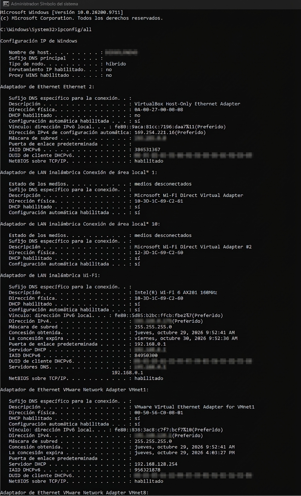
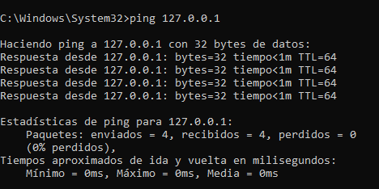
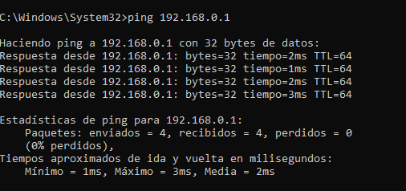
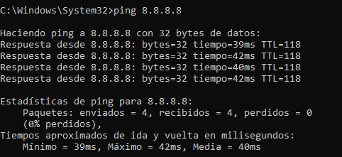
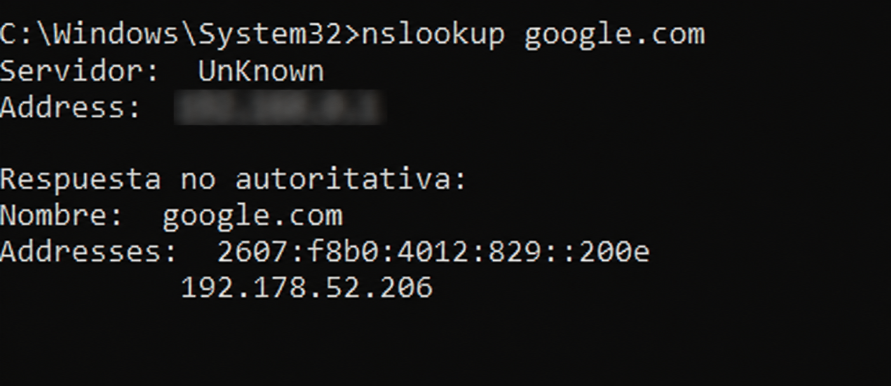
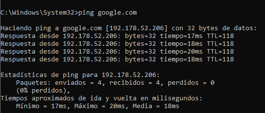
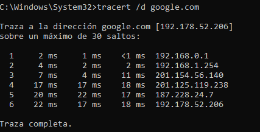

# Network Connectivity Troubleshooting

## Scenario

A user reports that they are unable to access the Internet.

This lab simulates a first-line Help Desk troubleshooting process for a Windows workstation. The goal is to identify where connectivity is failing by testing the connection step by step, starting from the local Windows network configuration and moving toward external connectivity.

---

## Objective

The objective of this lab is to practice a structured troubleshooting process for common Windows network connectivity issues.

The troubleshooting process used in this lab is:

```text
User reports a connectivity problem
            ↓
Gather information
            ↓
Check IP configuration
            ↓
Test the local TCP/IP stack
            ↓
Test the default gateway
            ↓
Test Internet connectivity
            ↓
Test DNS resolution
            ↓
Trace the network path if necessary
            ↓
Identify the likely cause
            ↓
Document the findings
            ↓
Resolve or escalate
```

---

## Environment

- Operating System: Windows 11
- Tools: Command Prompt, PowerShell
- Network: Local workstation connected to a network

---

## Tools Used

- `ipconfig`
- `ping`
- `nslookup`
- `tracert`

---

## 1. Check IP Configuration

The first step is to determine whether Windows has a valid network configuration.

```cmd
ipconfig /all
```

This command displays detailed TCP/IP configuration information, including:

- IPv4 Address
- Subnet Mask
- Default Gateway
- DNS Servers
- DHCP configuration

The **Default Gateway** is especially important because it is normally the device Windows uses to reach networks outside the local network.

**Evidence:**



---

## 2. Test the Local TCP/IP Stack

Next, test whether the local TCP/IP stack is functioning.

```cmd
ping 127.0.0.1
```

The address `127.0.0.1` is the IPv4 loopback address. It allows the computer to communicate with itself.

If this test succeeds, it indicates that the local TCP/IP stack is responding.

**Evidence:**



---

## 3. Test the Default Gateway

The next step is to test communication with the local network gateway.

Use the **Default Gateway** identified in the previous step:

```cmd
ping <Default-Gateway>
```

Example:

```cmd
ping 192.168.1.1
```

The actual gateway address will depend on the network configuration of the workstation.

If the gateway responds, the workstation can communicate with the local network gateway.

**Evidence:**



---

## 4. Test Internet Connectivity by IP Address

Next, test connectivity to an external IP address.

```cmd
ping 8.8.8.8
```

This test helps determine whether the workstation can reach an external network using an IP address without relying on DNS name resolution.

A successful ping does not prove that every Internet service is working, but it provides useful evidence about basic IP connectivity.

**Evidence:**



---

## 5. Test DNS Resolution

Next, test whether Windows can resolve a hostname into an IP address.

```cmd
nslookup google.com
```

`nslookup` queries a DNS server to resolve a domain name.

If the hostname resolves successfully, DNS is responding to the workstation.

**Evidence:**



---

## 6. Test Connectivity Using a Hostname

Now test connectivity using a hostname instead of an IP address.

```cmd
ping google.com
```

This allows the previous tests to be compared.

For example:

```text
ping 8.8.8.8      → Tests connectivity using an IP address
ping google.com   → Requires DNS resolution
```

If an IP address responds but a hostname does not, DNS becomes a likely area for further investigation.

**Evidence:**



---

## 7. Trace the Network Path

If necessary, use `tracert` to identify the path traffic takes toward the destination.

```cmd
tracert /d google.com
```

`tracert` displays the network hops between the workstation and the destination.

The `/d` option prevents reverse DNS lookups for the intermediate addresses, making the command faster and keeping the output focused on the route itself.

This information can help determine whether the problem may be occurring somewhere beyond the local workstation.

**Evidence:**



---

## Findings

The results of each test should be reviewed together rather than relying on a single command.

| Test | Purpose | Result |
|---|---|---|
| `ipconfig /all` | Verify network configuration | Pending |
| `ping 127.0.0.1` | Test local TCP/IP stack | Pending |
| Default Gateway ping | Test local network connectivity | Pending |
| `ping 8.8.8.8` | Test external IP connectivity | Pending |
| `nslookup google.com` | Test DNS resolution | Pending |
| `ping google.com` | Test hostname resolution and connectivity | Pending |
| `tracert /d google.com` | Examine network path | Pending |

---

## Troubleshooting Relevance

This workflow demonstrates a structured approach to network-related Help Desk incidents.

Instead of immediately assuming that the Internet connection is the problem, each test helps narrow down the possible cause.

For example:

- Invalid IP configuration → investigate DHCP or network configuration.
- `127.0.0.1` fails → investigate the local TCP/IP stack or Windows networking.
- Gateway fails → investigate the local network connection, Wi-Fi/Ethernet, or gateway.
- IP connectivity works but DNS resolution fails → investigate DNS.
- Local tests succeed but external connectivity fails → investigate the upstream network or ISP and consider escalation.
- Multiple network hops fail → document the evidence and escalate when appropriate.

---

## Escalation Criteria

A Help Desk technician should document the tests performed and escalate the issue when the problem appears to be outside the workstation's scope.

Examples include:

- ISP or upstream network problems
- Network infrastructure failures
- Persistent gateway connectivity problems affecting multiple users
- DNS server issues outside the workstation
- Problems requiring network administrator access

---

## Conclusion

This lab demonstrates a structured Windows network troubleshooting workflow rather than relying on a single connectivity test.

The main objective is to determine **where communication stops** and use the results to identify the most likely area of failure.

The same troubleshooting methodology can be applied to real Help Desk tickets involving Internet access, DNS problems, Wi-Fi connectivity, and other basic network issues.
