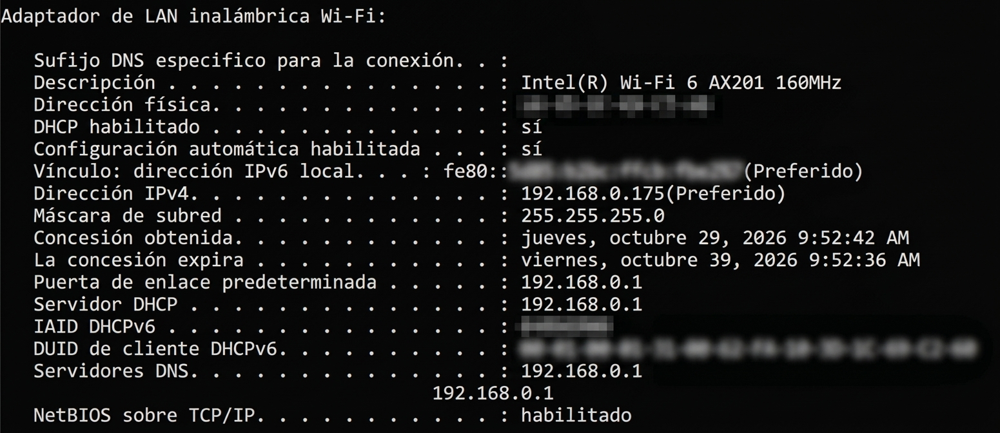
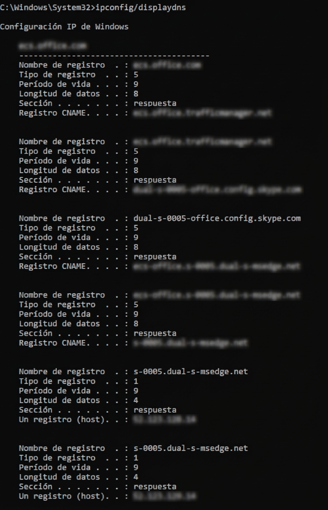
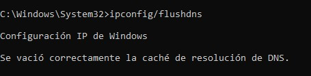
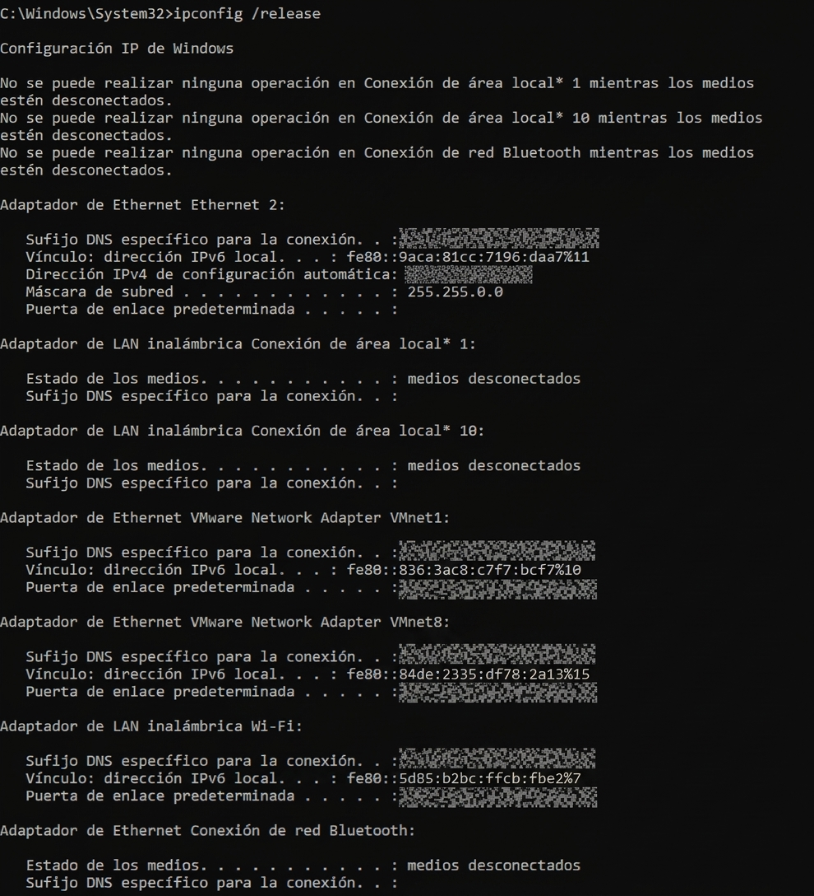
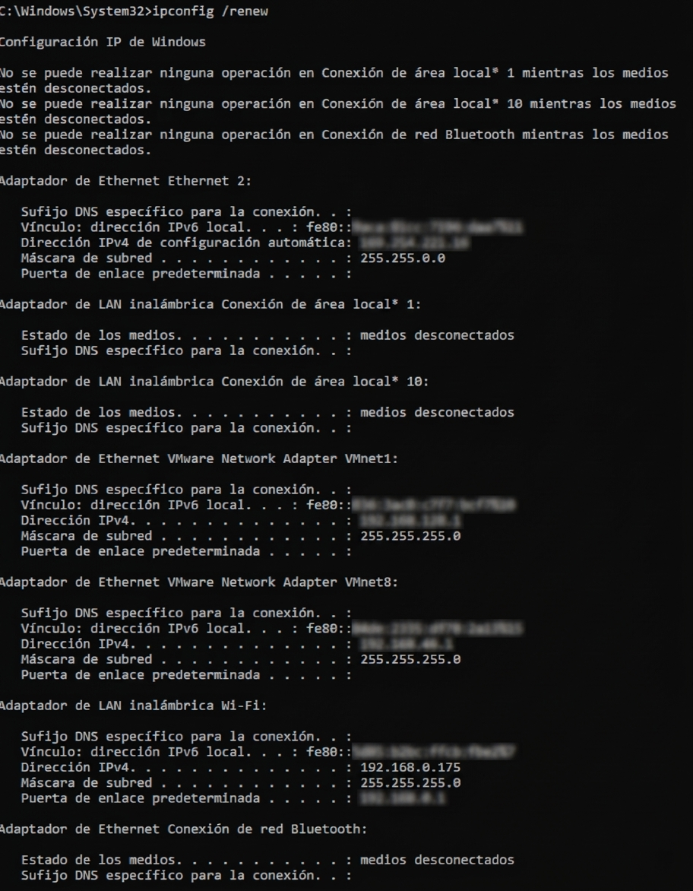
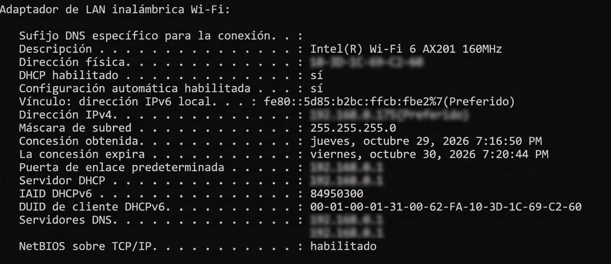

# DNS & DHCP Troubleshooting

## Objective

Troubleshoot common DNS and DHCP issues on a Windows client using standard Windows networking tools.

The lab focuses on identifying how the computer receives its network configuration, how DNS resolution works, and how to refresh DHCP and DNS information during troubleshooting.

## Scenario

A user reports that they are having problems accessing websites and resolving network resources.

As a Help Desk technician, the goal is to determine whether the issue is related to:

- DHCP configuration
- DNS configuration
- DNS cache
- Network configuration

## Environment

- Windows 11
- Wi-Fi network connection
- Command Prompt
- Windows networking tools

## Tools Used

- `ipconfig`
- `nslookup`
- `ipconfig /displaydns`
- `ipconfig /flushdns`
- `ipconfig /release`
- `ipconfig /renew`

---

## 1. Review DHCP and DNS Configuration

The first step is to review the network configuration assigned to the Windows client.

The main information reviewed includes:

- IPv4 address
- Subnet Mask
- Default Gateway
- DHCP Server
- DNS Servers
- DHCP status

### Command

```cmd
ipconfig /all
```

### Evidence



The active Wi-Fi adapter was identified and its DHCP and DNS configuration was reviewed.

The system was configured to obtain its network configuration automatically through DHCP, with the router providing the DHCP and DNS services.

---

## 2. Inspect the DNS Resolver Cache

Windows maintains a local DNS resolver cache containing information from previous DNS lookups.

Reviewing the cache can help determine whether previously resolved domains are being stored locally.

### Command

```cmd
ipconfig /displaydns
```

### Evidence



The cache contained previously resolved Microsoft and Office-related domains, demonstrating that Windows was storing DNS resolution information locally.

---

## 3. Test DNS Resolution

DNS resolution was previously tested in the Network Connectivity Troubleshooting lab using:

```cmd
nslookup google.com
```

The test confirmed that the configured DNS server could resolve `google.com` to an IP address.

Because this test and its terminal evidence were already documented in the previous lab, a second screenshot was not necessary here.

This result is used as supporting information for the DNS troubleshooting process.

---

## 4. Clear the DNS Resolver Cache

If cached DNS information is suspected to be outdated or incorrect, the local DNS resolver cache can be cleared.

### Command

```cmd
ipconfig /flushdns
```

### Evidence



The command completed successfully and Windows confirmed that the DNS resolver cache was cleared.

This provides a clean starting point for subsequent DNS resolution tests.

---

## 5. Release the DHCP Configuration

The current DHCP configuration was released from the network adapters.

### Command

```cmd
ipconfig /release
```

### Evidence



Windows released the DHCP configuration from the active network connection.

Some inactive or virtual adapters reported that their media was disconnected. These messages were expected because the computer contains several virtual network adapters that are not currently connected.

The active Wi-Fi connection was temporarily disconnected as expected.

---

## 6. Renew the DHCP Configuration

After releasing the DHCP configuration, Windows was instructed to request a new network configuration from the DHCP server.

### Command

```cmd
ipconfig /renew
```

### Evidence



The Wi-Fi adapter successfully received network configuration again after the DHCP renewal.

This confirmed that the client was able to communicate with the DHCP service and obtain the required network settings.

---

## 7. Verify the Final Configuration

The network configuration was checked again after the DHCP renewal.

### Command

```cmd
ipconfig /all
```

### Evidence



The final configuration confirmed that the Wi-Fi adapter had successfully recovered its:

- IPv4 address
- Subnet Mask
- Default Gateway
- DHCP Server
- DNS Server

The DHCP lease information was also updated after the renewal.

This confirmed that DHCP configuration was functioning correctly on the Windows client.

---

## Findings

| Test | Result | Finding |
|---|---|---|
| DHCP configuration | Passed | The Wi-Fi adapter was configured to obtain its network settings automatically |
| DNS cache review | Passed | Windows contained cached DNS records |
| DNS resolution | Passed | `nslookup` successfully resolved `google.com` |
| DNS cache flush | Passed | DNS resolver cache was successfully cleared |
| DHCP release | Passed | The existing DHCP configuration was released |
| DHCP renew | Passed | The Wi-Fi adapter successfully obtained network configuration again |
| Final configuration | Passed | IPv4, gateway, DHCP and DNS configuration were restored |

## Troubleshooting Relevance

This lab demonstrates a basic client-side troubleshooting workflow that can be used when a user reports problems accessing websites or network resources.

The troubleshooting process separates DNS-related issues from DHCP-related issues instead of assuming that every network problem has the same cause.

A Help Desk technician can use these steps to determine whether the Windows client has valid network configuration, whether DNS information is being cached, and whether renewing the DHCP configuration restores connectivity.

## Escalation Criteria

If the client cannot obtain a valid DHCP configuration after a release and renewal, or DNS resolution continues to fail after clearing the local cache, further investigation may be required.

Potential escalation areas could include:

- DHCP server availability
- Router or network infrastructure
- DNS server availability
- Network adapter issues
- Broader network outages

## Conclusion

The troubleshooting process confirmed that the Windows client was able to obtain valid network configuration through DHCP and successfully use DNS resolution.

The DHCP release and renewal process restored the client's network configuration, while clearing the DNS cache demonstrated an additional client-side troubleshooting step that can be used when DNS information may be outdated or incorrect.

